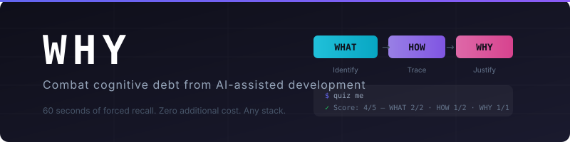
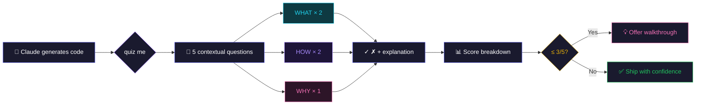

<p align="center">
  
</p>

<p align="center">
  <a href="https://ko-fi.com/joshobrien15789"></a>
</p>

<p align="center">
  
  
  
</p>

---

> *"Any fool can know. The point is to understand."* — Albert Einstein

WHY is a [Claude Code plugin](https://code.claude.com/docs/en/plugins) that questions/quizzes you on code you've accepted from Claude in Terminal. Instead of accepting instantly and moving on, you spend 60 seconds confirming you actually understand what was implemented. This may seem extreme to some, but there is a fundemental reason for it which I will get into below. 

Every question that will be asked from this is rooted in *your specific code* not generic textbook material.

## The Problem

The world is very quickly flying into an AI Enhanced world of programming and many of us know from experience that AI in itself is a brilliant and helpful tool at furthering the development of outputted code. Most tools/plugins and otherwise focus on the AI portion of this equation 'more-context'/'more-tools'/ 'more-mcps','more efficency'. However it is rare we focus on the other side of the coin. How often do most people using these tools in any walks of life/vibe coding or otherwise *understand fully* what has been created, or challenged themselves to understand  the code outputted by our AI companions. This is where we come to the human cost or: **cognitive debt**: this is just one of the gaps between what you ship/what you can debug, extend, or explain. It compounds silently for many unlucky souls until they are potentially staring at something that breaks, and at code they don't recognise.

## The Research

While it may have been coined elsewhere the term I use *cognitive debt* I have taken from a 2025 MIT Media Lab study that used EEG brain monitoring to measure what happens when people rely on LLMs - I will go further into this in a [Medium Article](https://medium.com/aiexploration/ai-assistance-or-the-battle-to-negate-our-human-cognitive-debt-747421fb593a). 
Below are some of the key takeaways summarised:

- **55% reduced neural connectivity** in LLM users compared to those working without AI assistance
- **83% of LLM users couldn't quote from work they'd produced minutes earlier** their brains never took any of it in
- **Ownership collapsed** — Some LLM users denied authorship entirely
- **The debt compounds over time** — when LLM users later worked without tools, they showed weaker neural connectivity than people who had never used LLMs at all

The researchers concluded that "repeated reliance on external systems like LLMs replaces the effortful cognitive processes required for independent thinking" and recommended combining AI assistance with tool free learning phases.

WHY is exactly that: a Claude Plugin/Human Positive learning phase embedded in your workflow. Sixty seconds of forced cognitive engagement after each implementation. While in no way do I see this as a cure all, it is a step in ensuring those of us still learning (all of us) continue to do so without taking a backseat to AI.

WHY won't turn you into someone who writes everything from scratch, neither would I want it to. AI I believe is a fundemental turning point in Software Engineering and is here to stay. That's not the point. It's that like financial debt/ cognitive deat compounds. WHY is harm reduction: 60 seconds of forced recall after an implementation, enough to encourage you to make your brain actually encode what happened. It won't replace genuine understanding, but it'll make you take a pause before shipping code you potentially couldn't describe/claim ownership of.

> Kosmyna, N., Hauptmann, E., et al. (2025). *Your Brain on ChatGPT: Accumulation of Cognitive Debt when Using an AI Assistant for Essay Writing Task.* MIT Media Lab. arXiv:2506.08872.
>
> **Paper:** [arxiv.org/abs/2506.08872](https://arxiv.org/abs/2506.08872) · **Project:** [brainonllm.com](https://www.brainonllm.com/) · **MIT Media Lab:** [media.mit.edu](https://www.media.mit.edu/publications/your-brain-on-chatgpt/)
>

## How WHY Works

WHY generates contextual multiple-choice questions across three tiers:

| Tier | Tests | Example |
|------|-------|---------|
| **WHAT** | Can you identify what was implemented? | "Which hook prevents re-renders on line 14?" |
| **HOW** | Can you trace how it works? | "What's the execution order when the form submits?" |
| **WHY** | Can you justify the approach? | "Why use a Map instead of a plain object for the cache?" |

5 questions per quiz (2 × WHAT, 2 × HOW, 1 × WHY), with explanations after every answer.



## Installation

### Claude Code

```bash
/plugin marketplace add jobrien874/why-plugin
/plugin install why@why-plugin
```

### Manual Installation

Clone this repo and point Claude Code at it:

```bash
git clone https://github.com/jobrien874/why-plugin.git
# Then in Claude Code:
/plugin install --path /path/to/why-plugin
```

## Usage

### Manual Quiz

After receiving code from Claude, say:

```
quiz me
```

or

```
/why
```

### Auto-Quiz Mode

Enable automatic quiz prompts after substantial code blocks:

```
enable why
```

Claude will offer a quiz after generating 50+ lines. Disable with `disable why`.

### Targeted Quiz

Point at specific code:

```
quiz me on the auth middleware
test me on lines 40-80
```

### Session Review

Quiz across everything from the current conversation:

```
quiz me on everything from this session
```

## Example Session

```
You: Build me a debounced search component in React

Claude: [generates component]

You: quiz me

Claude:
━━━━━━━━━━━━━━━━━━━━━━━━━━━━━━━━━━━━━━━━
  WHY Quiz — Debounced Search Component
  Question 1 of 5  [WHAT]
━━━━━━━━━━━━━━━━━━━━━━━━━━━━━━━━━━━━━━━━

What does the cleanup function returned by the useEffect
on line 22 do?

  a) Cancels the pending API request
  b) Clears the debounce timeout
  c) Resets the search input value
  d) Removes the event listener

Reply with a, b, c, or d.

You: b

Claude:
✓ Correct!

The cleanup function calls clearTimeout on the timeout ref,
preventing the debounced callback from firing if the component
unmounts or the dependency changes before the delay expires.
Option (a) is wrong because there's no AbortController in this
implementation — that would be a good enhancement.
```

## Scoring

After all questions, you get a tier breakdown:

```
  Score: 4/5 (80%)

  WHAT  ██████████ 2/2
  HOW   █████░░░░░ 1/2
  WHY   ██████████ 1/1

  💡 Your HOW score suggests you might want to trace
     through the data flow once more.
```

## How Triggering Works

WHY is a SKILL.md agent skill. 

| You say | What happens |
|---------|-------------|
| `quiz me` / `/why` / `test my understanding` | Quiz on the most recent substantial code block |
| `quiz me on the auth middleware` | Quiz scoped to the referenced section only |
| `quiz me on everything this session` | Review quiz spanning all code from the conversation (8 questions) |
| `enable why` / `auto-quiz on` | Turns on auto-quiz mode (see below) |
| `disable why` / `auto-quiz off` | Turns off auto-quiz mode |

**Auto-quiz mode** is opt-in. Once enabled, after generating 50+ lines of code, the agent appends a soft prompt: *"Ready to check understanding? Say 'go' for a quick WHY quiz, or keep moving."* You can ignore it entirely — no quiz is forced into the response. This mode persists for the session and resets when the conversation ends.

If you're clearly in a rush ("just give me the code", "skip the explanation"), WHY stays out of the way even in auto-quiz mode.

## Token Cost

As I know this topic will come up :) the only overhead is the extra tokens, which will be from the model you are currently using roughly 200–300 tokens per question/answer cycle, or ~1,500 tokens for a full 5-question quiz. In order to combat cognitive debt I think it's well worth the time/tokens spent.

**Tip:** Quiz generation doesn't need frontier-level intelligence. If you're running on Opus and want to save tokens, switch to Haiku or Sonnet before triggering the quiz:

```
/model
# select haiku or sonnet
quiz me
# switch back after
/model
```

## Roadmap

- [x] **v1.0** — Multiple choice, 3-tier questions, session scoring
- [ ] **v2.0** — "Explain It Back" free-text mode with LLM-as-judge scoring
- [ ] **v2.1** — Difficulty scaling based on historical performance
- [ ] **v3.0** — Interactive dashboard for claude.ai with persistent score tracking

## Philosophy

I have tried to enforce key points in the Skill, noted below, this is to prevent your performance effecting potential output of Claude.

- **Not a gatekeeper.** WHY never withholds code or blocks your workflow.
- **Not a test.** There's no pass/fail. A 2/5 is useful signal, not judgment.
- **Not generic.** Every question is grounded in your actual implementation.

The tone is that of a senior colleague or peer who wants you to succeed.

## Compatibility

WHY uses the universal [SKILL.md agent skill format](https://platform.claude.com/docs/en/agents-and-tools/agent-skills/overview) and works with:

## Contributing

Issues and PRs welcome. If you've got ideas for question patterns, difficulty scaling or really anything please start a discussion :) 

## Disclaimer

WHY like AI itself is not a replacement for common sense. A passing score doesn't mean your code is production ready, or even should be used at all. Likewise a failing score doesn't mean it isn't. Use your judgment. WHY is a learning aid, not a safety net.

## License

[MIT](LICENSE)

## Support

If WHY helps you in anyway or you like the idea, consider supporting development/buying me a coffee & or Guiness (€6.08 average price in Ireland [11/04/2026](https://guinndex.ai/)):

<a href="https://ko-fi.com/joshobrien15789">
  
</a>

---

Built by [Josh O'Brien](https://github.com/jobrien874)
